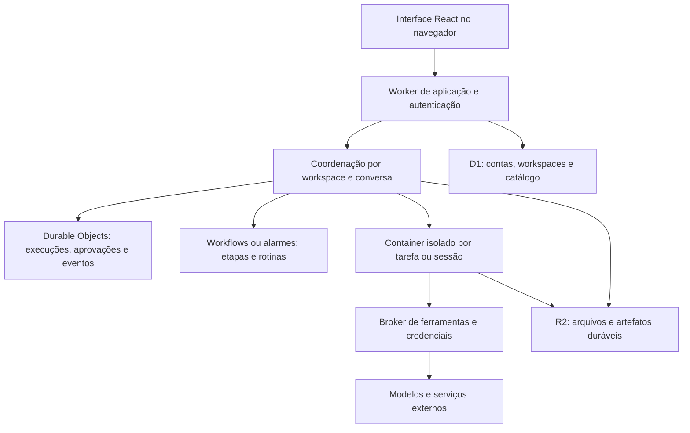

# Veltram: reconstrução do OpenMausBot na Cloudflare

Arquitetura e estado de implementação em 14 de outubro de 2026. Base do trabalho: `origin/local/patches`, commit `334f568d98639b84d0f8ed8e143fbb5a8c555bb4`, atualizado do remoto. A marca escolhida é Veltram e a versão `veltram-2026-10-14.2` está publicada em `https://veltram.com`. As seções de arquitetura descrevem também etapas futuras; o estado implementado é delimitado abaixo. Saúde HTTPS, arquivos, recebimento real de OTP, login e logout via API foram verificados. A navegação completa em produção ainda precisa ser conferida após atualizar o cache DNS local.

O objetivo é permitir usar o OpenMausBot pelo navegador e manter os agentes trabalhando na nuvem. A arquitetura recomendada preserva a interface React e os comportamentos úteis do produto, reconstrói a coordenação sobre serviços duráveis e executa comandos em ambientes Linux isolados.

## Escopo confirmado

O solicitante confirmou três decisões: todo o produto deve funcionar na Cloudflare, incluindo execução dos agentes com o Mac desligado; várias empresas devem ser atendidas desde a primeira versão; cada empresa conecta suas próprias chaves de IA (BYOK). Cada empresa terá seus próprios membros, bots, conversas, dados, credenciais e limites. Isolamento entre empresas faz parte do primeiro marco, e não de uma adaptação posterior.

Continuam pendentes os motores prioritários, necessidade de desktop gráfico, importação do histórico e limite de gastos da infraestrutura. O domínio próprio `veltram.com` substitui a proposta anterior de subdomínio de `nuria.run`; o endereço recomendado para o MVP é `https://veltram.com`, com interface e API na mesma origem. As credenciais iniciais são chaves de API fornecidas pelos administradores de cada empresa. A primeira entrega deve ser verificada com duas organizações distintas e dados deliberadamente parecidos para detectar acessos cruzados.

## Base existente examinada

| Área | Evidência no repositório | Consequência |
| --- | --- | --- |
| Interface | `src/`, `vite.config.ts`, `src/main.tsx` | React/Vite já funciona no navegador e se comunica com `/api`. Reaproveitar componentes e validar dependências do Electron por fluxo. |
| Conta Cloudflare | `cloudflare/control-plane/README.md`, `src/auth.ts` e `migrations/` nesse pacote | Conta, OTP, D1 e ownership de instalações são uma base. O próprio README exclui bots, conversas e SQLite local desse serviço. |
| Acesso remoto | `cloudflare/control-plane/README.md:20` | O túnel existente aponta para o gateway local em `127.0.0.1:8812`; continua dependendo de um computador ligado. |
| Integrações | `cloudflare/composio-broker/` | Há um broker Worker que protege a chave Composio. Sua identidade por instalação precisa ser adaptada ao workspace autenticado. |
| Motores | `server/drivers/claude.ts:2023`, `codex.ts:1003`, `acp/core.ts:1059` | CLIs são subprocessos, com diretório de trabalho, ambiente e comunicação por stdio. |
| Estado | `server/store.ts:497`, `message-db.ts:27`, `routines.ts:810` | JSON, SQLite e arquivos locais exigem migração explícita e contratos de durabilidade. |
| Browser e computador | `server/browser-runtime.ts:88`, `container-computer.ts:29` | Binários, processos e perfis precisam de ambiente de execução próprio. |
| Cloud atual | `deploy/fly/fly.toml`, `server/cloud-home.ts`, `docs/cloud-pro.md` | A solução cloud documentada usa máquina Fly e volume por cliente. Não é um backend integral em Workers. |
| Verificação | `docs/verification/README.md` | Fluxos de conversa e servidor devem ser exercitados em fixture isolada, com motor falso e dados temporários. |

Os arquivos de configuração Cloudflare presentes no fork não comprovam recursos disponíveis ou publicados na conta do solicitante. Não reutilizar seus IDs, domínios ou segredos no projeto novo.

## Alternativas avaliadas antes da definição de escopo

| Caminho | Vantagem | Limite |
| --- | --- | --- |
| Workers, estado durável e Containers/Sandboxes na Cloudflare | Atende ao escopo confirmado e permite preservar execução de código e CLIs. Caminho escolhido para a prova inicial. | Exige validar ciclo de vida, retomada, persistência, disponibilidade e custo dos containers. |
| Workers com agentes inteiramente reimplementados por APIs | Menos dependência de processos e imagens Linux para tarefas que usam apenas APIs. | Login, ferramentas, contexto e continuidade dos CLIs não são automaticamente preservados. Código arbitrário ainda requer executor isolado. |
| Cloudflare para painel e controle, executor no Mac ou VPS | Poderia reaproveitar mais do servidor atual durante uma transição. | Descartado para a operação normal: contraria o escopo confirmado de execução integral na Cloudflare. |

## Arquitetura recomendada

**Interface e API.** Publicar React com Workers Static Assets e uma API autenticada no mesmo domínio. Reaproveitar componentes aos poucos, com uma matriz de rotas e eventos que cubra o conjunto realmente habilitado. A UI atual inteira não deve ser apontada para uma API parcial e apresentada como funcional.

**Estado e conversas.** Usar Durable Objects para serializar comandos de uma conversa e manter eventos recuperáveis; o Agents SDK é uma opção de implementação. D1 mantém identidade, associação a workspaces e índices de consulta. Definir uma fonte de verdade por entidade: índices em D1 não decidem se uma execução terminou. Eventos usam identificador, sequência e cursor de retomada.

**Execução.** Um container recebe somente o workspace e as capacidades necessários para aquela tarefa ou sessão. Drivers existentes podem orientar os adaptadores; seu reaproveitamento depende de validação. Workers não oferecem implementação funcional de `node:child_process` ou `node:sqlite`, embora esses módulos possam ser importados como stubs. [Compatibilidade Node.js](https://developers.cloudflare.com/workers/runtime-apis/nodejs/).

**Continuidade.** Código e arquivos do container podem terminar com a instância. Snapshot não restaura processos em execução; a aplicação precisa retomar etapas com base em estado durável. Persistir artefatos em R2 e o estado de execução fora do container; não usar montagem de objetos como substituto presumido de disco POSIX/SQLite. [Ciclo de vida dos sandboxes](https://developers.cloudflare.com/sandbox/concepts/lifetime/).

**Rotinas.** Substituir timers do processo por agendamento durável. Cada disparo tem chave única e registro de tentativa. Novas tentativas não podem repetir silenciosamente uma ação externa: guardar intenção, chave de idempotência quando suportada e recibo, e reconciliar resultados incertos. Aprovações ficam persistidas durante espera, reinício e reconexão.

**Autoridade durante recuperação.** Cada tentativa recebe uma geração e uma concessão de execução com prazo. O coordenador, o broker e a gravação de resultados validam a geração ativa; cancelamento ou substituição revoga a anterior. Eventos atrasados de um executor antigo não podem concluir a tarefa, publicar artefatos oficiais ou iniciar novas ações. Uma operação externa já enviada antes da revogação pode ter ocorrido: reconciliar seu recibo antes de tentar novamente. Testar explicitamente o executor antigo enviando resultados e pedidos depois de uma retomada.

**Credenciais e autoridade.** Separar API administrativa, broker e execução. Credenciais gerais ficam fora do alcance do shell; capacidades concedidas são curtas, vinculadas a usuário, workspace, tarefa e ação. Um agente não pode aprovar sua própria solicitação. O servidor atual documenta confiança de loopback e usuário de sistema compartilhado em `docs/self-hosting.md:518`; essa premissa não serve como isolamento entre clientes.

**Organizações.** Toda operação deriva seu contexto de organização e papel de uma sessão autenticada e de associação validada no servidor. Um `organizationId` informado pelo cliente não concede acesso. Consultas, unicidade, exportações, eventos, cache, cotas, caminhos de objetos e nomes de Durable Objects incluem esse contexto. Prefixos em R2 e filtros SQL só funcionam como parte dessa autorização; não substituem a fronteira de acesso. Tokens internos ficam fora do navegador. Um membro de duas empresas troca de contexto explicitamente, sem compartilhar credenciais ou histórico entre elas.

**Isolamento e admissão.** Nenhum executor, HOME ou credencial persistida é compartilhado entre empresas. Preferir executor por tarefa/sessão e identidade de credencial, com aprovação e autoridade no controle externo. Limitar concorrência e consumo tanto por organização quanto no conjunto da conta Cloudflare; a política de containers `durable_object` não oferece `max_instances`, portanto a aplicação precisa controlar admissão. [Políticas de agendamento](https://developers.cloudflare.com/containers/configuration/scheduling-policy/).

**Computador e navegador.** Começar por tarefas de código e HTTP. Browser remoto, perfis, anexos, screenshots e intervenção humana recebem prova própria. Desktop Linux gráfico deve ser tratado como outra capacidade a validar. Controlar aplicativos e arquivos do Mac exige um componente local opcional; a nuvem sozinha não conserva essa função.

O modelo proposto combina as capacidades documentadas de [Agents](https://developers.cloudflare.com/agents/) e [Sandboxes](https://developers.cloudflare.com/sandbox/). A documentação atual marca o agendamento de sandbox por Durable Object e os snapshots como beta; validar acesso e comportamento na conta alvo antes de assumir paridade de produção.

## Primeira entrega funcional proposta

Usuários de duas organizações entram pelo navegador, criam seus próprios bots e conversas, enviam tarefas, acompanham eventos e decidem aprovações. Um usuário não consegue observar ou alterar os recursos da outra organização. Cada agente executa uma tarefa pequena em Linux na Cloudflare, salva um arquivo e mostra seu resultado. Fechar o navegador não encerra a tarefa; reabrir a conversa recupera os eventos.

O fluxo deve distinguir `queued`, `running`, `waiting_approval`, `succeeded`, `failed`, `cancelled` e interrupção com resultado externo incerto. Uma interrupção depois de despachar uma ação não comprova falha nem autoriza repeti-la. Sucesso de uma execução exige o resultado esperado e sua evidência. Publicar o novo app exige uma evidência separada: versão/commit, deployment, URL, saúde e teste funcional daquele ambiente.

Paridade com todo o desktop não faz parte desse primeiro marco. Rotinas, memória, importação, canais, equipes, múltiplos motores e computador gráfico entram na matriz de migração, com estado e critério próprios; não desaparecem do objetivo final por estarem fora do primeiro marco.

## Sequência de implementação e critérios de passagem

1. **Criar a fronteira multiempresa e provar a execução.** Preparar o pacote isolado `cloudflare/app/`, contextos autenticados de duas organizações e um motor falso em Linux. Demonstrar stream de saída, timeout, cancelamento, separação de arquivos e recuperação após substituir uma instância. Validar primeiro que IDs, cursores, callbacks e pedidos de aprovação de uma empresa não dão acesso à outra. Depois validar um motor real com autenticação explicitamente configurada. Passagem: tarefa concluída e recuperada na conta alvo, sem Mac e sem acesso cruzado.
2. **Completar o núcleo autenticado.** Implementar membros e papéis, workspaces, bots, conversas, execuções e aprovações no pacote novo. Reaproveitar padrões de `cloudflare/control-plane/` sem alterar o serviço existente. Passagem: revogação de membro e mudança de papel são respeitadas em comandos, streaming e aprovações; agente não acessa controles administrativos.
3. **Conectar a interface mínima.** Adaptar o cliente web e os eventos necessários para a primeira entrega. Passagem: enviar, acompanhar, aprovar/negar, cancelar e reconectar funcionam no navegador, inclusive após recuperar o executor.
4. **Trazer rotinas, memória e integrações.** Adaptar contratos de `server/routines.ts`, memória e `cloudflare/composio-broker/`. Passagem: repetição de entrega/evento e reinício não causam duplicação silenciosa; autorizações continuam revogáveis e auditáveis.
5. **Migrar dados com ensaio reversível.** Criar exportação/importação versionada para bots, conversas, ramificações, memórias, anexos e recibos. Operar primeiro em fixture; uma migração real depende de escopo e destino definidos. Passagem: contagens e referências reconciliadas, arquivos verificados, erros explícitos e origem preservada.
6. **Publicar e validar.** Usar recursos próprios e configuração por ambiente; comprovar a versão servida, autorização e fluxo completo. Passagem: URL acessível, tarefa real concluída, retomada validada e limites/custo observados. Não anunciar o produto migrado apenas por build, deploy ou resposta de saúde.

O pacote `cloudflare/app/` já contém interface web Veltram, Worker com login por código de e-mail, criação/troca de organizações, workspace inicial e administração de chaves BYOK. O login usa Better Auth com cookie de sessão; associações e papéis são consultados no D1 em cada operação. A camada nova não importa o pacote enterprise nem altera o control-plane existente. Não há broker de modelos, bots ou conversas com IA. Houve publicação, login/logout real via API e prova remota isolada do executor fixo; nenhum modelo de IA foi chamado.

O primeiro fluxo implementado é uma prova Linux explicitamente identificada como teste, não como agente de IA. `ExecutionRoom` persiste provas e aprovações por empresa; `Admission` controla as vagas globalmente; `LinuxExecutor` usa `ctx.container.exec()` com imagem gerenciada, rede externa desligada e nenhuma chave de provedor. O programa é fixo: grava e lê um arquivo, e só conclui com saída zero e conteúdo exatamente igual ao solicitado. O resultado fica persistido no Durable Object; R2 continua sendo etapa futura.

Os limites desta prova são uma execução por empresa, quatro simultâneas no conjunto, 30 admissões por hora no conjunto e 100 registros de prova no total por empresa. Ainda não há remoção ou retenção móvel do histórico. A aprovação define prazo absoluto de 60 segundos; o executor usa o menor prazo entre esse limite e 45 segundos a partir do recebimento, incluindo preparação. Cancelamento invalida a geração e impede despacho atrasado. Vagas, inclusive expiradas, só são reutilizadas depois da confirmação de parada do executor. Após despacho com resultado incerto, recuperação marca interrupção e não repete comandos automaticamente; um recibo concluído pode ser devolvido sem nova execução.

O pacote novo fixa Wrangler 4.151.0, preservando os outros Workers. A aceitação local com Wrangler/Docker verificou execução nativa, retorno do recibo sem repetição, cancelamento e prazo. No navegador da fixture foram observados login, criação de empresa, execução com artefato exato, separação de chave sintética ao trocar de empresa, cancelamento, logout e apresentação em largura de 390 px. A rodada final aprovou 92 testes (53 unitários e 39 de integração), tipos, build, dry-run de produção, oxlint sem avisos e `git diff --check`. A fixture remota confirmou execução Linux, recibo, cancelamento corrigido e recusa de despacho tardio, com [recibo e limpeza](../verification/evidence/2026-10-14-veltram-linux.json). A [receita de verificação](../verification/cloud-app.md) distingue essas provas da navegação completa em produção, ainda pendente. Uma imagem própria só será necessária quando a imagem gerenciada não atender ao motor escolhido.

### Credenciais por empresa

O administrador cadastra uma chave de OpenAI, Anthropic ou OpenRouter. A resposta informa apenas provedor, estado, versão e data da alteração. `configured` significa armazenada; não significa que o provedor validou a chave ou que um modelo executou. A chave é criptografada com AES-256-GCM antes de entrar no D1, autenticando empresa, provedor, identificador e versão da credencial. A chave mestra fica em um segredo do Worker, fora do banco. Não existe rota de recuperação do valor original.

Alterações exigem a versão observada pelo cliente. Cadastro, substituição e revogação registram auditoria na mesma transação da alteração. A revogação apaga o ciphertext ativo e incrementa a versão. O futuro broker deverá verificar essa versão e a autorização vigente antes de cada chamada, sem injetar a chave de longa duração em comandos ou arquivos do executor. A política de rotação da chave mestra, expiração de cópias de backup e cancelamento de chamadas de modelos já em trânsito permanecem pendentes de implementação e verificação próprias.

O teste local de autenticação usa um remetente simulado. Na configuração publicada, Email Sending foi habilitado para o domínio e seus registros DNS foram confirmados. O solicitante confirmou o recebimento real do OTP; login autorizado por API, sessão autenticada, cookie Secure/HttpOnly, logout e retorno a 401 foram verificados sem registrar dados pessoais ou segredos. O formato estruturado `EMAIL.send({to, from: {email, name}, subject, text, html})` é suportado pelo Email Service atual. Recursos, remetente, segredo de autenticação e chave mestra do Veltram são próprios. Não regenerar segredos em publicações de rotina. Nenhuma credencial do aplicativo local será importada implicitamente. [Workers API de e-mail](https://developers.cloudflare.com/email-service/api/send-emails/workers-api/).

## Verificação e entrega

Durante a migração, preservar as receitas de `docs/verification/` para os comportamentos reaproveitados. Exercitar mudanças no servidor existente exclusivamente com `scripts/control-omb.ts launch` e URL explícita da fixture. O pacote Cloudflare deverá ter testes próprios contra bindings locais e ambientes remotos isolados, nunca contra o app ou os dados reais do usuário.

Cobrir especialmente reconexão com cursor, expiração e negação de aprovação, cancelamento, duas solicitações simultâneas, perda de executor e efeitos externos com resultado incerto. Os testes devem observar resultados e autoridade, não apenas repetir a implementação.

Manter recursos Cloudflare e IDs próprios por ambiente. Definir teto de concorrência, timeout e orçamento antes da prova com serviços pagos. Estimar custo a partir de tempo de execução, memória/CPU, modelos, armazenamento e tráfego medidos; esta proposta não contém preço mensal inventado.

A auditoria inicial somente leitura confirmou acesso aos serviços necessários e Workers Paid já ativo. Em seguida foram provisionados recursos exclusivos do Veltram, aplicadas as duas migrações do D1, instalados segredos próprios e configurados domínio e remetente. A publicação usa explicitamente `wrangler.production.jsonc`; `wrangler.jsonc` continua local. A versão atual usa commit `42b962a5fbacecd75b7369c96b789e764c31d0d9`, release `veltram-2026-10-14.2` e versão Cloudflare `902dd974-dd94-4477-ac60-edc5567b0877`, confirmada no dashboard como ativa, Ready e com 100% do tráfego.

Saúde HTTPS respondeu 200 com serviço e release atuais, o JavaScript remoto correspondeu ao build local e o ciclo real de autenticação foi verificado por API. Essas verificações fixaram a resolução ao IP autoritativo, com TLS validado, porque o resolvedor do Mac ainda mantinha cache DNS negativo, embora DNS autoritativo, 1.1.1.1 e 8.8.8.8 já resolvessem o domínio. Revalidar navegação normal depois da atualização desse cache. A navegação e o fluxo multiempresa completo em produção ainda precisam de aceitação própria.

Workers Paid tem mínimo de US$5/mês por conta e é necessário para Containers e envio a destinatários arbitrários. O plano já estava ativo, sem nova contratação para esta etapa. E-mail inclui 3.000 envios mensais por conta, depois US$0,35/1.000. As franquias são compartilhadas com outros projetos e excedentes geram cobrança; concorrência e timeout não representam orçamento acordado. A publicação e a fixture remota passaram a consumir recursos da conta; a fatura incremental ainda não foi aferida. [Workers](https://developers.cloudflare.com/workers/platform/pricing/), [Email Service](https://developers.cloudflare.com/email-service/platform/pricing/), [Containers](https://developers.cloudflare.com/containers/platform/pricing/).

## Reaproveitamento e limites

Reaproveitar inicialmente a parte aberta do repositório, preservando avisos e atribuição. `enterprise/LICENSE` declara termos separados para `enterprise/`, incluindo produção e hospedagem a terceiros; suas funcionalidades não estão incluídas no reaproveitamento inicial proposto.

A arquitetura não pressupõe que uma assinatura de CLI autorize ou funcione da mesma forma em hospedagem. Validar cada motor e seu método de autenticação; eventual mudança para API deve ser uma decisão explícita de produto e custo.

O próximo passo de produto é escolher os motores prioritários e integrar o broker usando o BYOK já confirmado. A avaliação das referências abaixo deve orientar os adaptadores de IA depois da prova Linux fixa. O objetivo continua sendo um produto multiempresa integralmente na Cloudflare.

## Referências solicitadas e decisões de reaproveitamento

As referências foram lidas em versões fixas, sem executar seus instaladores ou agentes:

| Projeto | Revisão examinada | Papel recomendado |
| --- | --- | --- |
| OpenMausBot original | `cf26890224e270b0970e451a066be35f9209158e` | Referência principal de produto: bots, conversas, aprovações, memória, rotinas e ferramentas. Preservar também as regras específicas do fork local. |
| Cloudroom core | `d44dd8b9a6d272a5f601b980c00fade202d00d4c` | Referência de adaptadores de motores, identidade de sessão, eventos e recuperação. Possível executor especializado após prova; não é o controle multiempresa. |
| Cloudroom GUI | `b5efb8d902fd580262a6b0eeaa130f92d8340f4b` | Referência de apresentação e comunicação com sessões remotas; avaliar os componentes separadamente das dependências de desktop. |

### Cloudroom core

Adotar a distinção entre comando aceito, despachado, concluído e resultado incerto após reinício. O core deduplica `request_id` e não reenvia automaticamente trabalho cujo resultado ficou desconhecido. Adotar também o contrato de SSE com sequência e cursor, mantendo a confirmação durável fora do executor. [Lifecycle](https://github.com/davidondrej/cloudroom-core/blob/d44dd8b9a6d272a5f601b980c00fade202d00d4c/src/session/mod.rs#L302-L345), [SSE](https://github.com/davidondrej/cloudroom-core/blob/d44dd8b9a6d272a5f601b980c00fade202d00d4c/src/api/mod.rs#L1365-L1414).

Adaptar os drivers Claude, Codex e Pi como referência de tradução de eventos, resume/fork e conferência de identidade/modelo. Não herdar a política de execução: o driver Codex fixa `approvalPolicy: never` e `danger-full-access`, e Claude desliga prompts de permissão. A nova aplicação conserva aprovações e capacidades verificadas externamente. [Codex](https://github.com/davidondrej/cloudroom-core/blob/d44dd8b9a6d272a5f601b980c00fade202d00d4c/src/runtime/codex.rs#L73-L109), [Claude](https://github.com/davidondrej/cloudroom-core/blob/d44dd8b9a6d272a5f601b980c00fade202d00d4c/src/runtime/claude.rs#L31-L101), [Pi](https://github.com/davidondrej/cloudroom-core/blob/d44dd8b9a6d272a5f601b980c00fade202d00d4c/src/runtime/pi.rs#L31-L180).

O código atual envia histórico gzip JSONL por HTTPS e URLs temporárias de upload, embora o README ainda descreva PostgreSQL. Esse contrato pode inspirar um adaptador Worker/R2, sem acrescentar PostgreSQL externo. O servidor completo dessa API não está no core. Seu journal local e uploads assíncronos não dão, por si, durabilidade na perda do container. [Histórico](https://github.com/davidondrej/cloudroom-core/blob/d44dd8b9a6d272a5f601b980c00fade202d00d4c/src/session/history.rs#L1-L18), [Uploads](https://github.com/davidondrej/cloudroom-core/blob/d44dd8b9a6d272a5f601b980c00fade202d00d4c/src/session/history.rs#L119-L171).

O core usa token geral de API e pressupostos de usuário Linux, diretórios e credenciais; não representa identidade e papéis de várias empresas. Seus recursos de secrets também entregam valores ao agente. Caso algum componente seja incorporado, mantê-lo privado e isolado por organização/identidade, sem token administrativo no navegador, fila autoritativa paralela ou credenciais gerais no shell. [Autorização](https://github.com/davidondrej/cloudroom-core/blob/d44dd8b9a6d272a5f601b980c00fade202d00d4c/src/api/mod.rs#L470-L485), [Secrets](https://github.com/davidondrej/cloudroom-core/blob/d44dd8b9a6d272a5f601b980c00fade202d00d4c/src/secrets/mod.rs#L234-L257).

### Cloudroom GUI

Adotar o padrão de conferir cada recibo contra sessão, `request_id` e comando enviados. Adotar também atualização atômica de projeção e cursor: uma reconexão não deve duplicar mensagens ou avançar o cursor sem os eventos correspondentes. Na nossa fronteira esses contratos incluem organização, workspace e geração ativa. [Validação de recibos](https://github.com/davidondrej/cloudroom-gui/blob/b5efb8d902fd580262a6b0eeaa130f92d8340f4b/gui/apps/server/src/services/cloudroom/client.ts#L477-L499), [Projeção e cursor](https://github.com/davidondrej/cloudroom-gui/blob/b5efb8d902fd580262a6b0eeaa130f92d8340f4b/gui/apps/server/src/services/cloudroom/events.ts#L466-L470).

A interface React/Vite tem candidatos de reaproveitamento pontual: timeline virtualizada, renderização de conversas e componentes que distinguem aprovação, pergunta e revisão de plano. Avaliar extração com os contratos necessários, sem importar o transporte desktop inteiro. [Timeline](https://github.com/davidondrej/cloudroom-gui/blob/b5efb8d902fd580262a6b0eeaa130f92d8340f4b/gui/apps/app/src/components/thread/timeline/TimelineWindowedItems.tsx), [Interações pendentes](https://github.com/davidondrej/cloudroom-gui/blob/b5efb8d902fd580262a6b0eeaa130f92d8340f4b/gui/apps/app/src/components/thread/pending-interactions/ThreadPendingInteractionBanner.tsx).

O GUI é Electron/Node/React e tem um caminho remoto que ainda retorna indisponível para criação de conversa sem o Mac, além de omitir interações pendentes nesse modo. Isso limita esse frontend/fallback específico; não demonstra incapacidade do core remoto. Não incorporar o fallback que modifica globalmente `window.fetch`. Criar um cliente explícito da API Cloudflare. [Limites do fallback cloud](https://github.com/davidondrej/cloudroom-gui/blob/b5efb8d902fd580262a6b0eeaa130f92d8340f4b/gui/apps/app/src/cloud/cloud-server.ts#L164-L193), [Interações offline](https://github.com/davidondrej/cloudroom-gui/blob/b5efb8d902fd580262a6b0eeaa130f92d8340f4b/gui/apps/app/src/cloud/cloud-server.ts#L451-L460).

Não copiar como base de isolamento seu schema de projetos/conversas e seu cache de API: esses pontos não têm contexto empresarial explícito. O `accountId` de bindings desktop não equivale a associação de membros e papéis. Cache privado no produto novo precisa ser vinculado à sessão/organização e invalidado em logout, troca de empresa e revogação; começar sem cache de respostas sensíveis. [Schema](https://github.com/davidondrej/cloudroom-gui/blob/b5efb8d902fd580262a6b0eeaa130f92d8340f4b/gui/packages/db/src/schema.ts#L549-L653), [Service worker](https://github.com/davidondrej/cloudroom-gui/blob/b5efb8d902fd580262a6b0eeaa130f92d8340f4b/gui/apps/app/public/sw.js#L58-L72).

Ambos os projetos Cloudroom declaram Apache-2.0. O GUI também contém `NOTICE` com atribuição MIT herdada de BB; eventual cópia de componentes deve conservar os avisos aplicáveis. Nenhum código Cloudroom foi incorporado neste trabalho. Os testes desses repositórios não foram executados, e a leitura não comprova funcionamento na Cloudflare. [Licença core](https://github.com/davidondrej/cloudroom-core/blob/d44dd8b9a6d272a5f601b980c00fade202d00d4c/LICENSE), [Licença GUI](https://github.com/davidondrej/cloudroom-gui/blob/b5efb8d902fd580262a6b0eeaa130f92d8340f4b/LICENSE), [NOTICE](https://github.com/davidondrej/cloudroom-gui/blob/b5efb8d902fd580262a6b0eeaa130f92d8340f4b/NOTICE).

### OpenMausBot original e fork local

O repositório original é o upstream já configurado neste projeto. Seu modo Cloud continua documentado como máquina Fly pessoal por cliente; não equivale ao SaaS multiempresa solicitado. Reaproveitar o comportamento do produto e receitas de verificação, substituindo a hospedagem e o controle de acesso. [Cloud home](https://github.com/milind-soni/OpenMausBot/blob/cf26890224e270b0970e451a066be35f9209158e/docs/cloud-pro.md).

Não substituir o fork inteiro pelo upstream: na comparação das revisões examinadas, `server/bot-autonomy.ts`, `server/prod-delivery.ts` e `server/result-contract.ts` do fork não existem nesses caminhos no upstream. Seus critérios de autonomia e prova de resultado precisam de uma matriz explícita de preservação. O diretório `enterprise/` mantém termos separados; a arquitetura multiempresa própria não pressupõe copiar esse pacote. [Licença enterprise](https://github.com/milind-soni/OpenMausBot/blob/cf26890224e270b0970e451a066be35f9209158e/enterprise/LICENSE).

### Decisão resultante

Manter OpenMausBot como referência do produto e aproveitar seletivamente os contratos de execução e componentes do Cloudroom. Construir autenticação empresarial, autorização, estado durável, broker e admissão como núcleo próprio na Cloudflare. Antes de escolher um runner completo, comparar os adaptadores com os mesmos testes de aprovação, identidade, cancelamento, recibos, recuperação e isolamento. Uma interface visual convincente ou um CLI que responde não satisfazem esses critérios.
